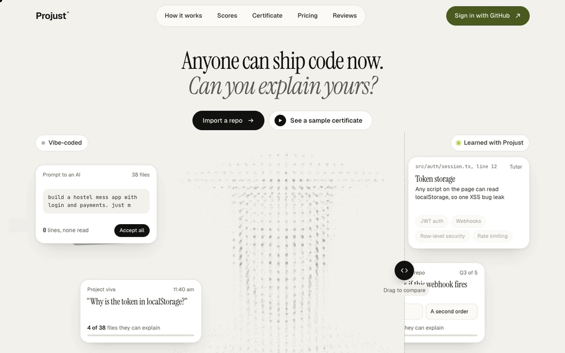
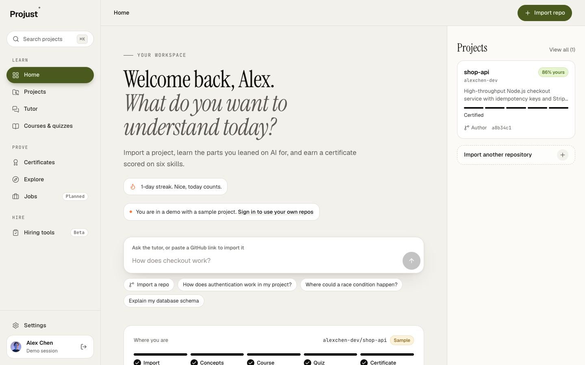
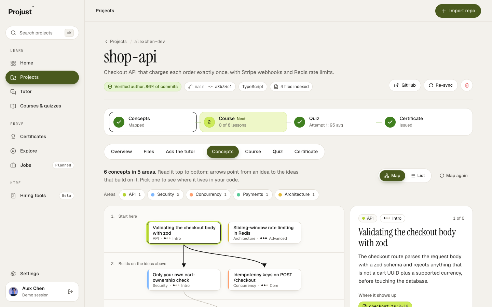
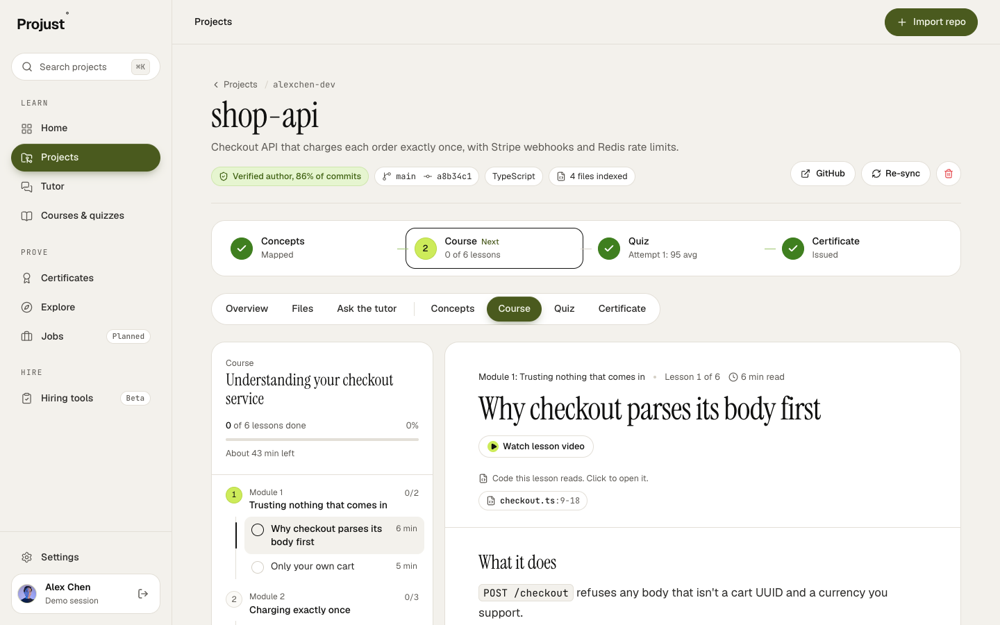
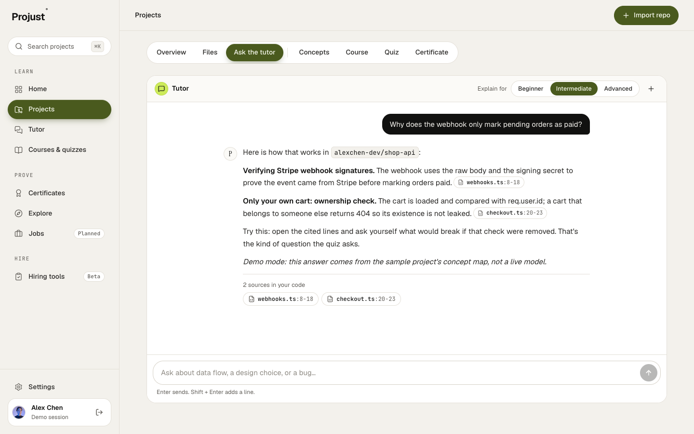
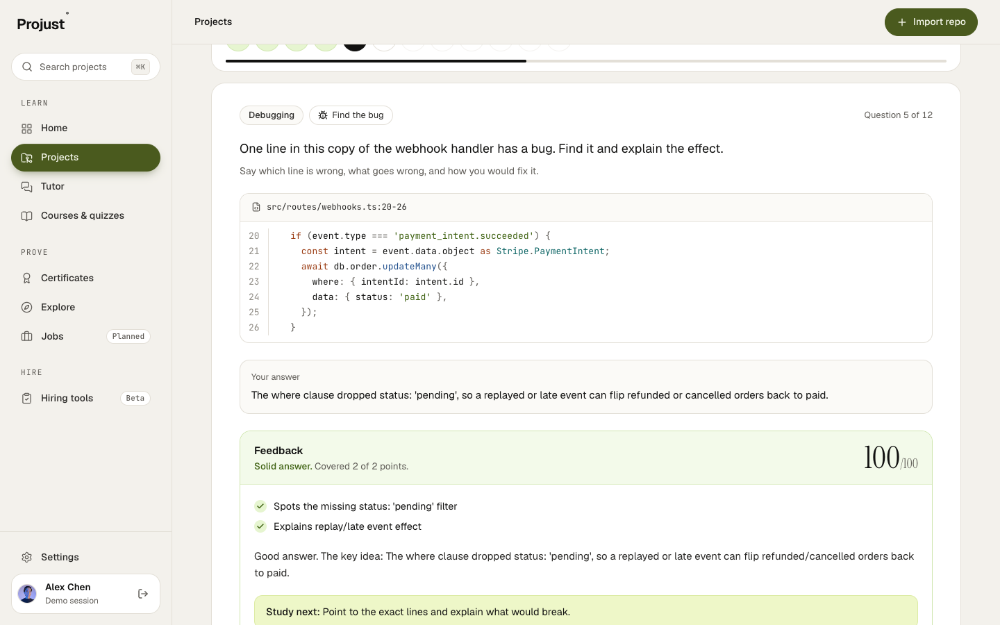
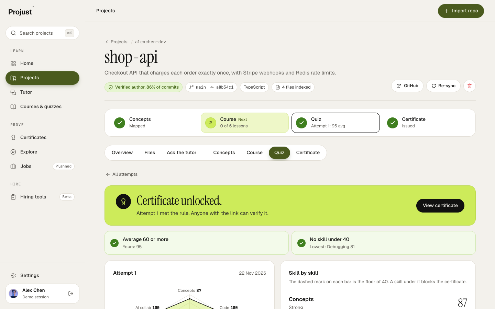
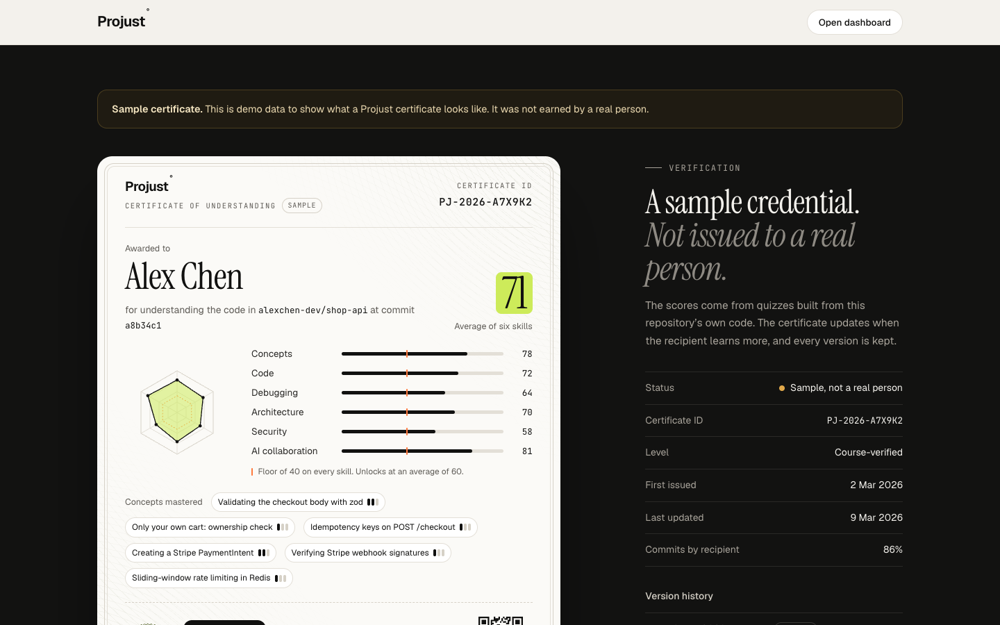
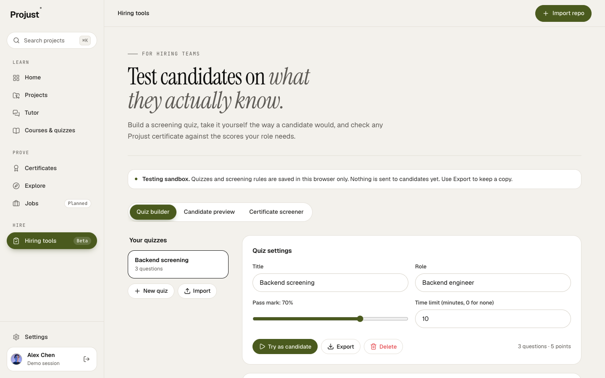
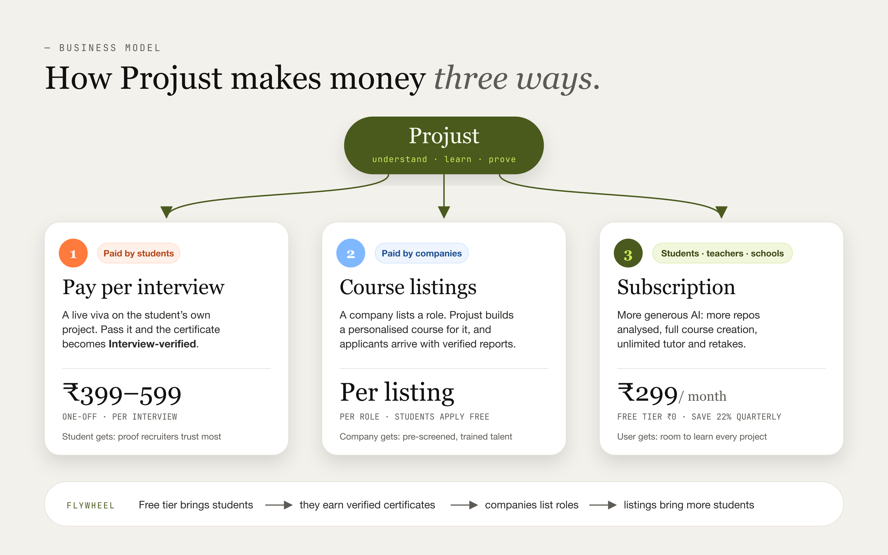

# Projust

**Proof you understand the code you shipped.**

Projust turns any GitHub repository into a personal course, a tutor that cites your own files, quizzes only
your repo can answer, and a live certificate that teachers and recruiters can check by ID.

*Project + justice: fair credit for students who understand what they build.*

| | |
|---|---|
| **Stack** | Next.js 14 (App Router) · TypeScript · Tailwind · Supabase (Postgres) · Firebase Auth · Claude (Anthropic SDK) · Remotion |
| **Demo** | `npm run dev` → `/login` → *"look around with demo data"* (no API keys needed) |
| **Sample certificate** | `/cert/PJ-2026-A7X9K2` |
| **Pitch deck** | [`docs/Projust-Pitch.pptx`](docs/Projust-Pitch.pptx) |
| **Business model** | [`docs/business-model.png`](docs/business-model.png) |



<sub>Real app in demo mode: dashboard → concept map → course → cited tutor → quiz feedback → certificate.</sub>

### Screenshots

| | |
|---|---|
|  |  |
| **Dashboard.** Where you are and what to do next | **Concept map.** Every idea in the repo, pinned to its lines |
|  |  |
| **Personal course.** Lessons written from your own code | **Tutor.** Answers cite exact files and line ranges |
|  |  |
| **Quiz feedback.** Every rubric point shown, 0–100 | **Results.** Six skill scores; certificate unlocks at 60+ |
|  |  |
| **Public certificate.** Verifiable by ID or QR, with version history | **Hiring tools.** Quiz builder and certificate screener for HR |

---

## Contents

1. [The problem](#1-the-problem)
2. [The solution](#2-the-solution)
3. [What makes it different (USP)](#3-what-makes-it-different-usp)
4. [Features](#4-features)
5. [Who it is for](#5-who-it-is-for)
6. [Business model](#6-business-model)
7. [How it works (architecture)](#7-how-it-works-architecture)
8. [Run it locally](#8-run-it-locally)
9. [Environment variables](#9-environment-variables)
10. [Database](#10-database)
11. [Project structure](#11-project-structure)
12. [Testing](#12-testing)
13. [Limits and assumptions](#13-limits-and-assumptions)
14. [Future scope](#14-future-scope)

---

## 1. The problem

**Anyone can ship code now. Few can explain it.**

AI tools write working apps in minutes. A student can demo a full login, dashboard and payments flow, then
freeze when a professor asks one question about the code.

- **Students** skip the learning and get caught out in vivas and interviews.
- **Teachers** can grade the demo, but not the understanding behind it.
- **Recruiters** spend interview rounds finding out the hard way. Résumé checkers read what a résumé says,
  not what its owner knows.

A résumé can list a project. It cannot show that the person understands it.

## 2. The solution

One loop: **understand → learn → prove.**

1. **Connect a repo.** Sign in with GitHub and pick a project. Projust skips `node_modules`, builds and lockfiles,
   ranks the files that matter and checks how much of the code the user actually committed.
2. **See its concepts.** A concept map of every idea the project uses (JWT auth, idempotent webhooks,
   row-level security…), each pinned to the exact lines that use it.
3. **Learn with a tutor.** A personalised course built from the user's own code, plus a chat tutor whose
   answers cite files and line ranges. The tutor explains, but never hands out quiz answers.
4. **Prove it in quizzes.** Questions only this repo can answer (multiple choice, *explain*, *find the bug*,
   *what if*), graded 0–100 against a rubric written from the code, across six skills.
5. **Earn a live certificate.** It unlocks at an average of 60 with no skill below 40. It has a public ID,
   a QR code and version history, and it updates as the student keeps learning.

## 3. What makes it different (USP)

| Others | Projust |
|---|---|
| Generic courses on generic topics | A course generated from **your own repository** |
| Tutor answers from the internet | Tutor answers **cite your files and line numbers** |
| Quizzes anyone could Google | Questions **only your codebase can answer** |
| One pass/fail grade | **Six skill scores**: concepts, code reading, debugging, architecture, security, AI collaboration |
| Static PDF certificate | **Live, versioned certificate** anyone can verify by ID or QR |
| Trusts the uploader | **Commit-ownership check**: shows what share of the repo the student actually wrote |

Other details that matter:

- **Transparent grading.** Students see every rubric point, can flag a grade they think is wrong, and missing
  pieces go into their study plan.
- **Fair to AI users.** "AI collaboration" is a scored skill. Using AI is fine; not understanding the output is the problem.
- **Built for everyone at the interview table.** One record serves the student, the teacher and the recruiter.

## 4. Features

| Area | What it does | Where |
|---|---|---|
| Repo import | GitHub OAuth or a public URL; streams the tarball, filters, ranks and redacts secrets | `src/lib/ingest/` |
| Ownership | Commit-author share: `verified`, `partial` or `not_owner` | `src/lib/ingest/ownership.ts` |
| Tutor | Streaming chat grounded in the repo, with clickable `[[file:12-30]]` citations that open a code viewer | `src/app/(app)/tutor`, `AskTab.tsx` |
| Concept map | Concepts grouped by category, each linked to code ranges | `src/lib/brain/concepts.ts` |
| Personal course | Modules and lessons generated from the repo's concepts | `src/lib/brain/course.ts` |
| Quizzes | Four question types, rubric grading, retakes, per-skill scores | `src/lib/brain/quiz.ts`, `score.ts` |
| Certificates | Public page, OG image, QR, version history | `src/app/cert/[code]` |
| Video explainers | Remotion concept explainers and a certificate reveal with voice and sound | `src/components/video/` |
| Hiring tools (beta) | Quiz builder, candidate preview, certificate screener against a role's score bar | `src/app/(app)/hiring` |
| Usage tracking | Token usage per project, daily free-tier limits | `src/lib/ai/usage.ts` |
| Streaks and dashboard | Learning streak, next-step card, projects panel | `src/components/dashboard/` |

## 5. Who it is for

| User | What they get |
|---|---|
| **Student** | A tutor built from their own project, interview prep on the code they will be asked about, and a certificate to share |
| **Teacher** | A fair check that a submitted project matches what the student understands; class view and fork flags (planned) |
| **Recruiter** | A one-page report by certificate ID: strengths, weak spots and ten questions worth asking |
| **Company** | Post a role, get a course built for it, and receive verified reports from applicants |

## 6. Business model



Projust earns from three streams.

### 1. Pay per interview (paid by students)
A one-off fee for a **live viva on the student's own project**. A successful viva upgrades the certificate from
*Course-verified* to **Interview-verified**, the level recruiters trust most.
- Indicative price: **₹399–₹599 per interview**.

### 2. Personalised course listings (paid by companies)
Companies list a role and pay per listing. Projust builds a **custom course for that role** (for example
payments and queues for a backend intern). Applicants learn it and apply with a verified report.
- Companies pay per listing. **Applying is always free for students.**

### 3. Subscriptions (paid by students, teachers and institutions)
A monthly or quarterly plan that unlocks **more generous AI usage**: more repos analysed, full course
generation, unlimited tutor questions, retakes and the full certificate report.
- **Free:** ₹0, 1 project, limited tutor questions a day, first course modules, basic certificate.
- **Pro:** ₹299/month (save 22% on the 3-month plan).
- **Teachers and institutions:** seat-based plans for class-wide analysis (planned).

**Why it works:** the free tier brings students in, students bring verified talent, verified talent brings
companies, and company listings bring more students.

## 7. How it works (architecture)

```
 GitHub repo ──► Ingest pipeline ──► Postgres (Supabase)
                 filter · rank ·      projects, project_files (tsvector),
                 redact · ownership   concepts, courses, quizzes, certificates
                                              │
                         ┌────────────────────┼─────────────────────┐
                         ▼                    ▼                     ▼
                  Tutor (RAG)          Concept map → Course     Quiz → Grade → Score
                  file router +        (Claude, cached per      (rubric from code,
                  full-text search     commit)                  six skills)
                         │                                          │
                         └──────────────► Certificate ◄─────────────┘
                                          public /cert/[code], QR, versions
```

- **AI provider.** Every AI step (summary, tutor, concepts, course, quiz, grading) goes to Claude through the
  Anthropic SDK. If a call fails, it falls back to optional OpenAI-compatible backends (`AI_SERVER_*`,
  `LLM_ALT_*`, `LLM_*`). See `src/lib/ai/provider.ts` and `claude.ts`.
- **Retrieval.** A fast LLM file router plus Postgres full-text search (`tsvector`); no vector DB is needed yet.
- **Caching.** Analysis is cached per commit, so a re-sync only redoes what changed.
- **Auth.** Firebase (GitHub, Google, email) with signed session cookies; repo access uses a separate GitHub
  OAuth app with tokens encrypted with AES-256-GCM.

## 8. Run it locally

```bash
npm install
cp .env.example .env   # then fill in the keys you have
npm run dev            # or `npm run demo` for a production build on http://localhost:3000
```

Run **one** server at a time from this folder. Two `next dev` processes share `.next` and break each other
("Cannot find module ./vendor-chunks/..."). If that happens, stop them all, `rm -rf .next`, and start one.

Routes at a glance:

- `/`: the landing page (static `public/landing.html`). Its "Sign in" / "Import a repo" buttons go to `/login`.
- `/login`: GitHub, Google, email, or **"look around with demo data"** (no keys needed; set
  `ALLOW_DEMO_MODE=false` to hide it).
- Demo walkthrough: dashboard → Projects → `alexchen-dev/shop-api` → Concepts → Course → Quiz → Certificate.
  Demo progress lives in server memory, so restarting the server resets it.
- `/hiring`: HR testing tools (quiz builder, candidate preview, certificate screener).
- `/cert/PJ-2026-A7X9K2`: the sample certificate.

### Live run with Claude (real repo → course → certificate)

1. Put your key in `.env`: `ANTHROPIC_API_KEY=...` and restart the server.
2. Create the tables: run the SQL migrations in the Supabase SQL editor (see [Database](#10-database)).
3. In Firebase console → Authentication → Sign-in method, turn on GitHub and Google and keep `localhost`
   in Authorized domains.
4. Sign in with GitHub or Google (not demo), import a **public** repo, then Concepts → Course → Quiz.

### GitHub OAuth app (repo access)

1. GitHub → Settings → Developer settings → OAuth Apps → New OAuth App.
2. Homepage URL: `http://localhost:3000`. Callback URL: `http://localhost:3000/api/github/callback`.
3. Copy the Client ID into `GITHUB_REPO_CLIENT_ID` and a new secret into `GITHUB_REPO_CLIENT_SECRET`.

## 9. Environment variables

All variables are listed with comments in [`.env.example`](.env.example). The main groups:

| Group | Variables | Notes |
|---|---|---|
| Per-user AI | Settings → AI (no env var) | Each user can pick a provider and model and add their own key; stored encrypted in their browser |
| Shared AI access | `SHARED_AI_ALLOWED_EMAILS` | Who may use the server's keys: empty = everyone, `none`, or a comma list of emails |
| Claude | `ANTHROPIC_API_KEY`, `AI_CLAUDE_MODEL`, `AI_CLAUDE_EFFORT` | Primary shared AI. Default model `claude-opus-5-5` |
| Fallback AI | `AI_SERVER_*`, `LLM_ALT_*`, `LLM_*` | Any OpenAI-compatible API; tried in that order |
| GitHub | `GITHUB_REPO_CLIENT_ID`, `GITHUB_REPO_CLIENT_SECRET`, `GITHUB_SERVER_TOKEN` | Repo access app, separate from login |
| Security | `TOKEN_ENCRYPTION_KEY`, `SESSION_SECRET`, `ALLOW_DEMO_MODE` | Generate your own keys with `openssl rand -base64 32` |
| Limits | `MAX_REPO_ARCHIVE_MB`, `MAX_FILES_PER_PROJECT`, `MAX_FILE_KB`, `ASK_CONTEXT_TOKEN_BUDGET`, `FREE_DAILY_ASK_LIMIT` | Defaults: 25 MB, 400 files, 100 KB, 60k tokens, 20 asks/day |
| Firebase | `NEXT_PUBLIC_FIREBASE_*` | Auth |
| Supabase | `NEXT_PUBLIC_SUPABASE_URL`, `SUPABASE_SERVICE_ROLE_KEY`, `NEXT_PUBLIC_SITE_URL` | Database |

**Deploying:** see [docs/DEPLOY.md](docs/DEPLOY.md) (Vercel, env upload without printing secrets, Firebase domains, cost controls).

## 10. Database

For a fresh database, run `003_firebase_and_learning.sql` and then `004_ai_usage.sql` in the Supabase SQL
editor. `003` is self-contained: it also creates everything from `002`.

| Migration | Creates |
|---|---|
| `002_feature1.sql` | The original Feature 1 schema (kept for history) |
| `003_firebase_and_learning.sql` | `github_connections` (AES-256-GCM tokens), `projects`, `project_files` (with `tsv` full-text index), `chat_threads`, `chat_messages`, `usage_daily`, `concepts`, `courses`, `lesson_progress`, `quiz_attempts`, `certificates` |
| `004_ai_usage.sql` | `ai_usage`: AI token usage per project |

## 11. Project structure

```
src/
├── app/
│   ├── (app)/            # signed-in app: dashboard, projects, tutor, courses, certificates,
│   │                     # explore, jobs, hiring, settings
│   ├── (auth)/login/     # sign-in page
│   ├── api/              # route handlers: projects, quiz, certificates, github, search, profile
│   ├── cert/[code]/      # public certificate page + OG image
│   └── u/[username]/     # public profile
├── components/           # ui, layout, learning (Concepts/Course/Quiz/Certificate tabs),
│                         # project (code viewer, ask tab), video (Remotion), dashboard, charts
├── lib/
│   ├── ai/               # Claude + fallback providers, prompts, usage, citations
│   ├── brain/            # concepts, course, quiz, scoring, demo data, service layer
│   ├── ingest/           # pipeline, file filter, prioritiser, ownership
│   ├── auth/ firebase/ supabase/ github/ data/
└── types/                # shared types (learning, certificates, profiles)
supabase/migrations/      # SQL schema
tests/                    # node test suites
public/landing.html       # landing page
docs/                     # pitch deck, business model image, demo GIF, screenshots/
```

## 12. Testing

```bash
npm test          # ingestion (crypto, filtering, secret redaction, ranking, citations),
                  # learning/quiz/demo flow, Claude provider, video text cleaning
npx next build    # production build check
node --experimental-strip-types scripts/seed-demo.ts   # seed the demo project
```

## 13. Limits and assumptions

- **Repo size.** Archives are capped at 25 MB and 400 files by default for fast in-memory processing.
- **No vector DB yet.** Retrieval uses the LLM file router plus Postgres full-text search. A stub for hybrid
  search is in `src/lib/ai/embeddings.ts`.
- **Demo mode** uses canned sample data and keeps progress in server memory.
- **Hiring tools** are a sandbox: quizzes and rules are saved in the browser only for now.
- **Jobs and interviews** are shown as *Planned* in the app and are not live yet.

## 14. Future scope

| Horizon | What |
|---|---|
| **Next** | Live AI + human **viva interviews** (pay per interview) and the *Interview-verified* level |
| | **Company listings** with role-specific courses and applicant reports |
| | Hiring tools backed by the database, so candidates get a quiz link and results reach the recruiter |
| **Soon** | **Teacher class view**: compare submissions, flag forks and copied projects |
| | Hybrid vector + full-text search for very large repos; private-repo support at scale |
| | GitLab and Bitbucket import |
| **Later** | Integrations with ATS tools and LinkedIn; university LMS plugins |
| | Multi-language tutor and voice viva |
| | Team and enterprise plans for onboarding engineers onto an existing codebase |

---

© 2026 Projust
